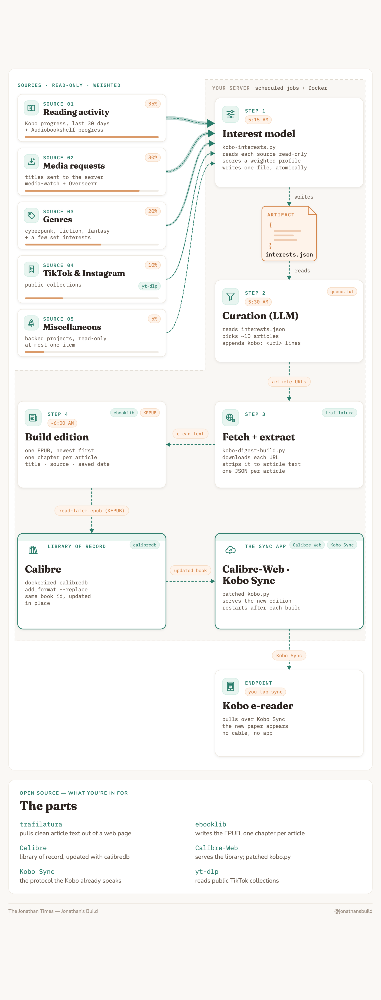

# kobo-morning-paper: a morning newspaper for your Kobo

Every morning a fresh EPUB of about 10 articles appears on your Kobo. You tap sync. No cable, no app.



This repo is the code behind that pipeline. You run it on your own server. Nothing here calls a hosted service except the sites you read and, optionally, your own LLM.

## How it works

1. **Interest model** (`scripts/kobo-interests.py`, 5:15 AM) reads up to five sources, read-only, and writes one file: `interests.json`.
   - Reading activity 35%: Kobo progress for the last 30 days (from Calibre-Web), plus Audiobookshelf progress.
   - Media requests 30%: titles you asked your server to fetch (a JSONL log and/or Seerr/Overseerr requests).
   - Genres 20%: your standing genres from `config.json`.
   - TikTok & Instagram 10%: public TikTok collections, read with yt-dlp. The code reads TikTok collections only; Instagram has no reader in this repo.
   - Miscellaneous 5%: backed projects, at most one item. The code reads Kickstarter "You just backed" emails over IMAP.
   - If a source is not configured or fails, its weight moves to Reading activity and Media requests (35:30), and `interests.json` says why.
2. **Curation** (5:30 AM): an LLM reads `interests.json` and picks about 10 articles into `queue.txt`. This step is **yours to plug in**. See `curate.example.sh` for the contract. No curation agent ships in this repo.
3. **Fetch + extract** (`scripts/kobo-digest-build.py`, 6:00 AM): trafilatura turns each URL into clean article text.
4. **Build edition**: ebooklib writes one EPUB, newest first, one chapter per article, with a generated cover and a tappable front page.
5. **Calibre**: `calibredb add_format` replaces the format on the same book in place, then `scripts/kepub_ensure.py` adds a KEPUB.
6. **Calibre-Web, Kobo Sync**: Calibre-Web offers the new edition over the Kobo Sync protocol.
7. **Kobo**: tap sync.

`scripts/kobo-queue.py` is a small intake helper. It reads a message, finds lines that look like `kobo: https://...`, and appends them to `queue.txt`. Anything that can run a command can feed it (a chat bot, an SSH shortcut).

## What you need

- A server that runs scheduled jobs (cron) and Docker
- Calibre and Calibre-Web, with Kobo Sync turned on
- A Kobo e-reader
- An LLM, or any tool, for the curation step
- Python 3.10 or newer

## Setup

1. **Install.**
   ```
   git clone https://github.com/jstriblet/kobo-morning-paper.git
   cd kobo-morning-paper
   python3 -m venv .venv
   .venv/bin/pip install -r requirements.txt
   ```
   `opencv-python-headless` and `numpy` are only for the lead-image face filter. `yt-dlp` is only for TikTok collections.

2. **Configure.** `cp config.example.json config.json`, then edit it. The keys that matter first:
   - `data_dir`: where the pipeline keeps `queue.txt`, `articles/`, `interests.json` and the EPUB.
   - `paper_title`, `paper_tagline`: printed on the cover and front page.
   - `calibre_library`: the folder that holds Calibre's `metadata.db`.
   - `calibre_web_app_db`: Calibre-Web's `app.db`.
   - `kobo_user_id`: the Calibre-Web user id that owns the Kobo.
   - Source keys (`audiobookshelf_container`, `media_watch_file`, `seerr_*`, `tiktok_collections`, `genres`, `kickstarter_enabled`). Leave a source empty to skip it.

   Scripts find the file through `KOBO_PAPER_CONFIG`, then `./config.json`, then the repo root. `config.json` is in `.gitignore`.

   For the Kickstarter source, set `KOBO_IMAP_USER` and `KOBO_IMAP_PASSWORD` in the environment. The password never goes in the config file.

3. **Fonts (optional).** The cover uses UnifrakturMaguntia and PT Serif TTF files. They are not in this repo. Put them in `<data_dir>/fonts/` (names are set by `masthead_font`, `serif_bold_font`, `serif_regular_font`). Without them the build still works and uses Pillow's built-in font.

4. **Calibre-Web Kobo Sync shelf (required).** Kobo Sync only offers books that are on a shelf with Kobo Sync turned on.
   - In Calibre-Web, create a shelf and turn on "Sync this shelf with Kobo".
   - Put the paper book on it. The build script re-adds the book to the first `kobo_sync` shelf on every run and clears Calibre-Web's "already synced" marker, so each refresh is offered again.
   - Calibre-Web must run with Kobo Sync enabled, and the Kobo must be pointed at it (`api_endpoint` in the Kobo's config).

5. **KEPUB note.** A Kobo handles a KEPUB better than a plain EPUB (for example, highlights survive). `scripts/kepub_ensure.py` converts the EPUB with `kepubify` inside the Calibre-Web container (the linuxserver `calibre-web` image includes it) and adds the KEPUB format to the same book. Set `library_owner` to the uid:gid that owns your library.

6. **Run once by hand.**
   ```
   .venv/bin/python scripts/kobo-interests.py          # writes interests.json
   cp curate.example.sh curate.sh                       # edit it: your LLM step
   printf 'https://example.com/an-article\n' >> ~/kobo-articles/queue.txt
   .venv/bin/python scripts/kobo-digest-build.py       # builds the EPUB, updates Calibre
   ```
   Then sync the Kobo. To build only the EPUB without Calibre, set `"calibre_enabled": false`, or run `kobo-digest-build.py --dry-build DIR` against a folder that holds `articles/*.json`.

7. **Schedule.** `crontab.example` has the 5:15 / 5:30 / 6:00 AM lines. Edit the paths and add them to your cron table.

## Files

- `scripts/kobo-interests.py`: the interest model.
- `scripts/kobo-queue.py`: `kobo:` URL intake.
- `scripts/kobo-digest-build.py`: fetch, extract, build the EPUB, update Calibre.
- `scripts/kepub_ensure.py`: KEPUB conversion.
- `scripts/kobo_config.py`: shared config loader and defaults.
- `curate.example.sh`: the curation contract.
- `tests/test_smoke.py`, `fixtures/`: smoke test, no network and no Calibre.

## Test

```
.venv/bin/python -m pytest
```

The smoke test builds an EPUB from two fixture articles.

## Open-source parts

trafilatura, ebooklib, Calibre and Calibre-Web, yt-dlp, Kobo Sync.

## License

MIT
